# homesol

**Solar planning for any property, anywhere.** Tap your roof, or outline a piece of land, and get the whole decision on one screen: where each panel would go, what shades it and when, how much it would generate, and what it would cost and save after subsidy. Then ask questions about your own plan in English or Hindi, by typing or speaking.

**▶ Watch the 3-minute demo:** https://www.youtube.com/watch?v=QwJxYxqNJF4

**Live:** https://main.d37cbq8cojkdix.amplifyapp.com · **How every part works:** [docs/how-it-works.md](docs/how-it-works.md) · **Status and open work:** [docs/handoff.md](docs/handoff.md)

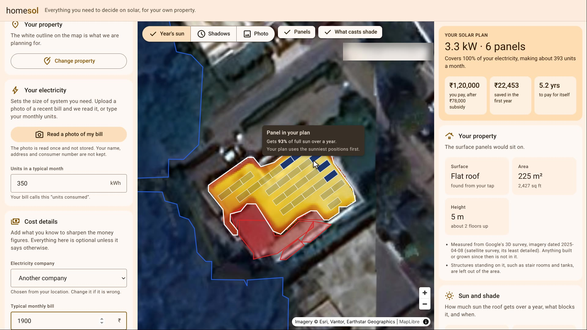

## The problem

A household thinking about rooftop solar usually has to invite installers round to learn the basics: how big a system fits, what it costs after subsidy, how long it takes to pay back, and whether the neighbour's tree matters. Each quote sizes and prices differently, none of them shows the shade, and the subsidy and net-metering rules are spread across government portals and distributor tariffs. India's PM Surya Ghar scheme wants 10 million homes to go solar, and each of them starts with these questions.

homesol answers them from a single tap, in about a minute, with every figure showing where it came from.

## What you get

| | |
|---|---|
| 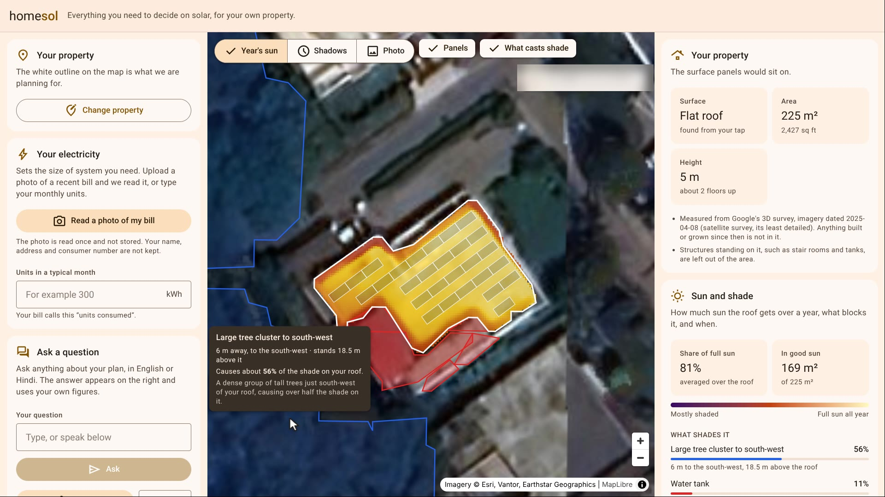 | **What shades the roof, measured and named.** Every tree, tank, stair room and neighbouring building is found in Google's 3D survey and measured: how tall, how far, which way, and what share of the shade it causes. Claude looks at the photo with each one numbered and says what it is. It names things; it never changes a measurement. |
| 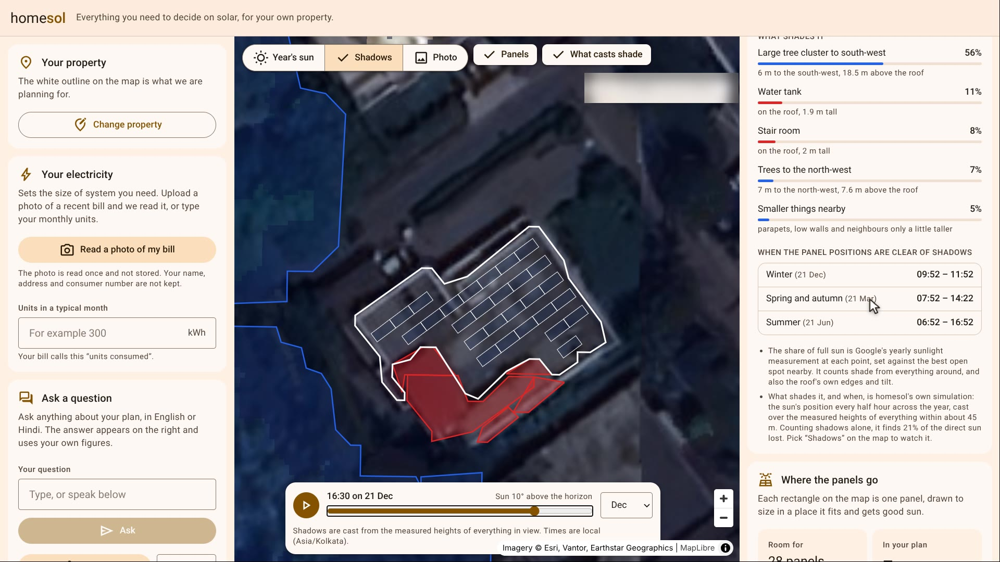 | **Shadows at any hour of the year.** The browser casts shadows from the measured heights every half hour across the year, works out which obstruction costs how much sun, and when the panels are clear. Drag the time or press play to watch a day. |
| 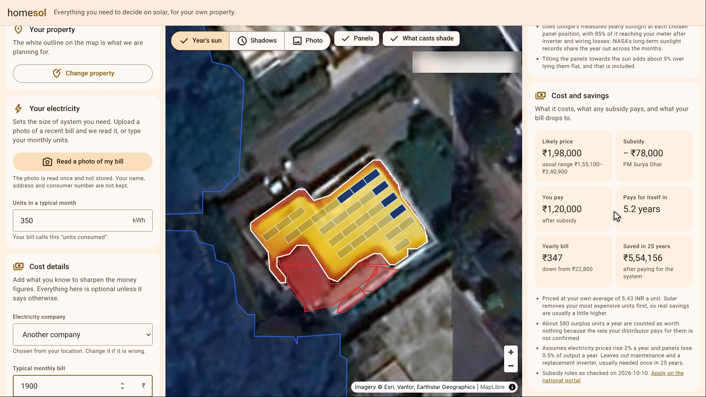 | **Cost, subsidy and payback.** In India: the PM Surya Ghar subsidy, the distributor's tariff slabs and net-metering rules, each with its source. Elsewhere: savings from the household's own bill in the local currency, with no invented subsidy or price. Upload a photo of the bill and Claude fills in units, amount, distributor and sanctioned load. |
| 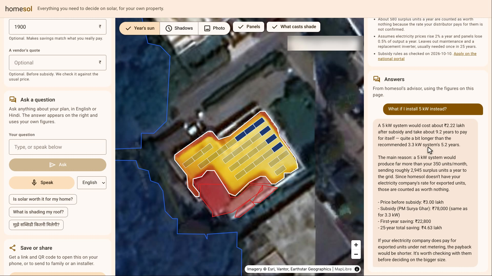 | **An advisor that only uses your figures.** A Strands Agents advisor on Claude answers in the language you ask in, by text or by voice through Amazon Transcribe. For "what if" questions it re-runs the same finance code the page uses, so it quotes the calculator, not a guess. |

Real-size panels are laid out in tilted rows on flat roofs and flush on slopes, facing the equator in either hemisphere, clear of edges and rooftop structures, sunniest positions first. Sizing combines each position's measured yearly sunlight with NASA POWER's monthly climate record and stops when the year's electricity use is covered. Plans can be saved and opened on another device by link or QR code.

Where Google has no 3D survey, homesol says so and falls back to an estimate from obstructions the user marks by hand, with height from a satellite shadow or a skyline scan using the phone's compass and tilt sensors.

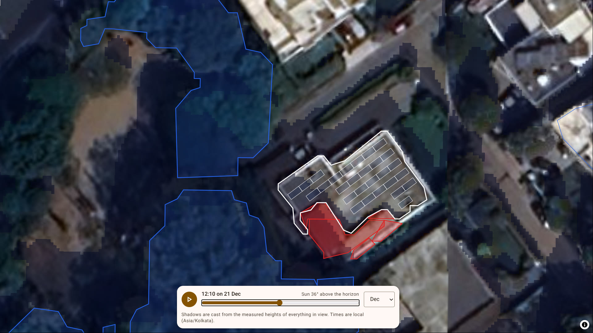

## Three rules behind every number

1. **Models perceive and explain; code calculates.** Every number on screen comes from deterministic code. Claude reads bills, names what the measurements found and writes answers. It is given numbers and is never asked to work them out.
2. **Measured beats estimated.** Where Google has surveyed a place, everything is measured and nothing needs marking by hand. Where it has not, the screen says the result is an estimate.
3. **Every figure says where it came from.** Policy entries carry a source link and a `verified` flag; the results say whether shade was measured or estimated and how old the imagery is.

## How a plan is made

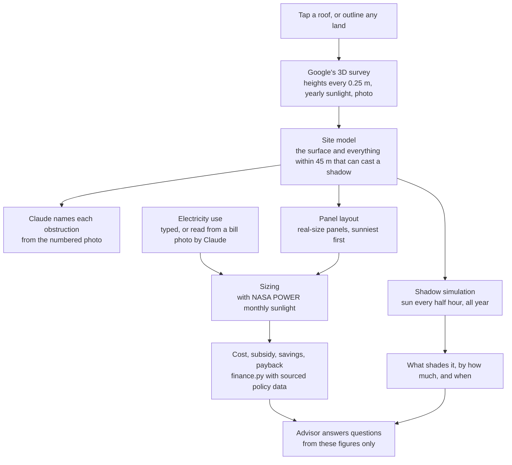

The server builds the site model once from Google's survey: a grid of measured heights, measured yearly sunlight and labels covering the property and about 45 m around it. Everything after that (the sun map, moving shadows, shade attribution and panel layout) runs in the browser from that one grid, so changing the month, the time or the household's figures is instant and free.

## Architecture

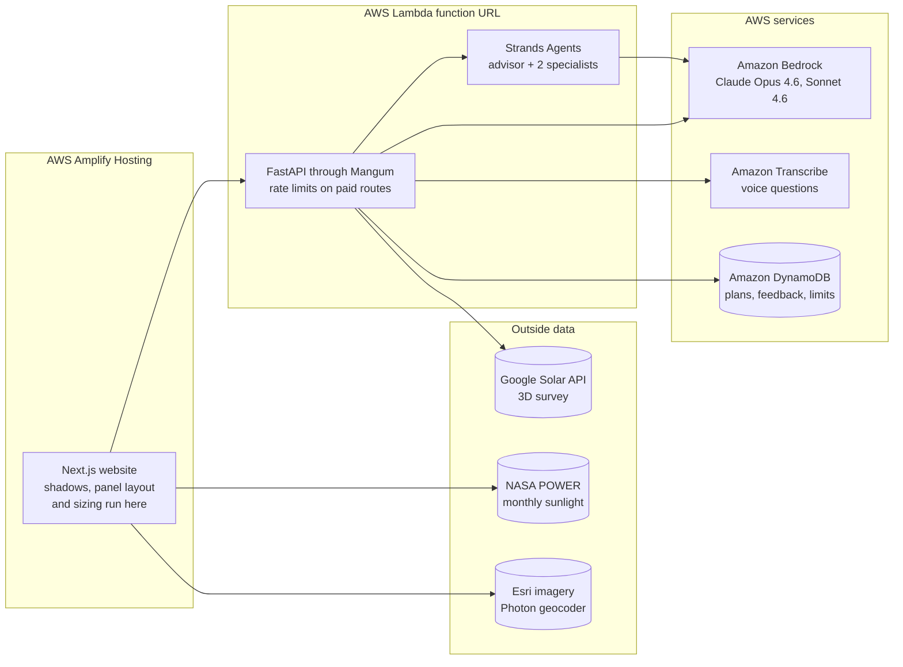

### Built on AWS

| Service | What it does in homesol |
|---|---|
| **Amazon Bedrock** | Claude Opus 4.6 names obstructions from an annotated photo, reads electricity bills and runs the advisor; Claude Sonnet 4.6 runs the advisor's two specialists |
| **Strands Agents SDK** (AWS open source) | The advisor agent, its site analyst and policy-and-finance analyst as agent tools, and their calculator tools, which are bound to the household's own survey so a model cannot supply its own usage or generation figures |
| **Amazon Transcribe** | Streaming speech to text for voice questions in Indian English and Hindi |
| **AWS Lambda** | The whole API (Python 3.13, arm64) behind a function URL, at most 10 requests at once. It reaches Bedrock, Transcribe and DynamoDB through its IAM role, so no AWS key is stored in it |
| **Amazon DynamoDB** | `homesol-surveys` for saved plans (expire after 90 days), `homesol-feedback` for detection verdicts, `homesol-limits` for rate-limit counters (removed once their hour or day is over) |
| **AWS Amplify Hosting** | The website, a static export of `web/` |
| **Amazon S3** | The Lambda deployment package |

## The advisor, and how it was tested

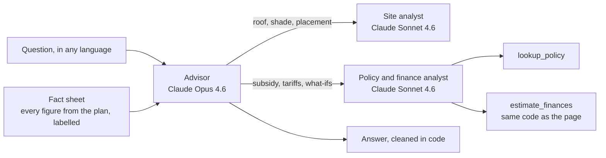

Most questions are answered straight from the fact sheet. The rest go to a specialist, and every calculator result is passed back word for word so the advisor quotes it rather than paraphrasing it.

`api/evals/` holds **81 test questions** across 11 households (India and abroad, roofs and land, measured and estimated), in English, Hindi, Hinglish and German, some with two turns. Automatic checks cover the answer's language and script, its currency, whether every figure can be traced to the plan, what-if recalculation, tool arguments, length, markdown and leaked reasoning. A second model grades four more, and it is never the advisor's own model.

Final run of the chosen models, 11 October 2026 ([`api/evals/runs/20261011-final-opus-sonnet`](api/evals/runs/20261011-final-opus-sonnet/summary.txt)):

| | Result |
|---|---|
| Questions passing every automatic check | 80 of 81 |
| Automatic checks passed | 789 of 790 |
| Graded checks passed | 198 of 204 |
| Time to answer | median 7.4 s, 90% under 13.5 s |
| Cost | about $0.04 an answer |

**Choosing the models.** Five pairings answered the same 26 questions:

<picture>
  <source media="(prefers-color-scheme: dark)" srcset="docs/images/model-pairings-dark.svg">
  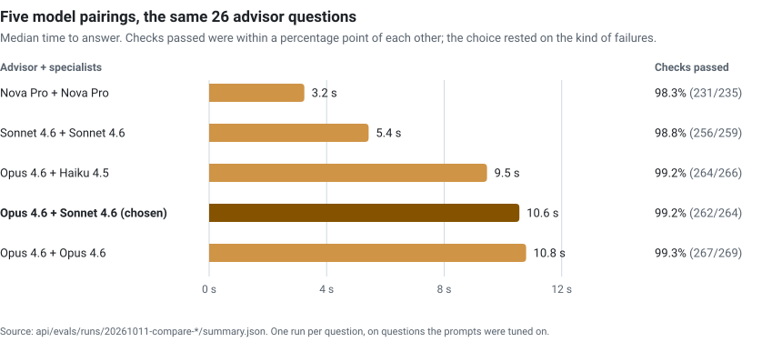
</picture>

| Advisor + specialists | Median answer | Automatic checks passed |
|---|---|---|
| Nova Pro + Nova Pro | 3.2 s | 98.3% (231 of 235) |
| Sonnet 4.6 + Sonnet 4.6 | 5.4 s | 98.8% (256 of 259) |
| Opus 4.6 + Haiku 4.5 | 9.5 s | 99.2% (264 of 266) |
| **Opus 4.6 + Sonnet 4.6 (chosen)** | **10.6 s** | **99.2% (262 of 264)** |
| Opus 4.6 + Opus 4.6 | 10.8 s | 99.3% (267 of 269) |

The pass rates are within a point of each other, so the choice rested on what the failures were. Nova answered a Hindi question in English and worked out a payback itself that disagreed with the calculator. Sonnet's Hindi replies were about a third English, and it named government bodies from memory. Opus did neither. Opus specialists added about two seconds for no gain; Haiku specialists were a second faster but looser with the site facts. These 26 questions lean towards ones that need a specialist, which is why their times run longer than the full set's.

These figures are one run per question, on questions the prompts were tuned on, so they are optimistic; [section 14 of how-it-works](docs/how-it-works.md#14-advisor-ai-chat) lists the known faults.

## Rate limits

The live site is public with no login, so every route that costs money has an allowance. Visitors are told apart by a salted hash of their IP address; the address itself is never stored.

| Allowance | Routes | Each visitor, per hour | All visitors together, per day |
|---|---|---|---|
| Live measurements (Google Solar API) | `/site`, `/picture` | 60 | 1,500 |
| AI answers and readings (Claude on Bedrock) | `/site/names`, `/bill`, `/detect`, `/advise` | 30 | 600 |
| Voice questions (Amazon Transcribe) | `/transcribe` | 30 | 500 |

Shadows, panel layout, sizing, cost and savings, saving and sharing are never limited: they run in the browser or cost nothing. Counters live in DynamoDB with atomic increments, so all Lambda instances share them. Allowances can be changed without code through the `RATE_LIMITS` setting.

When a limit is reached, the API answers `429` with what was limited, for whom and for how long, and the page says so plainly: which allowance ran out, a live countdown to when it comes back, and what still works in the meantime.

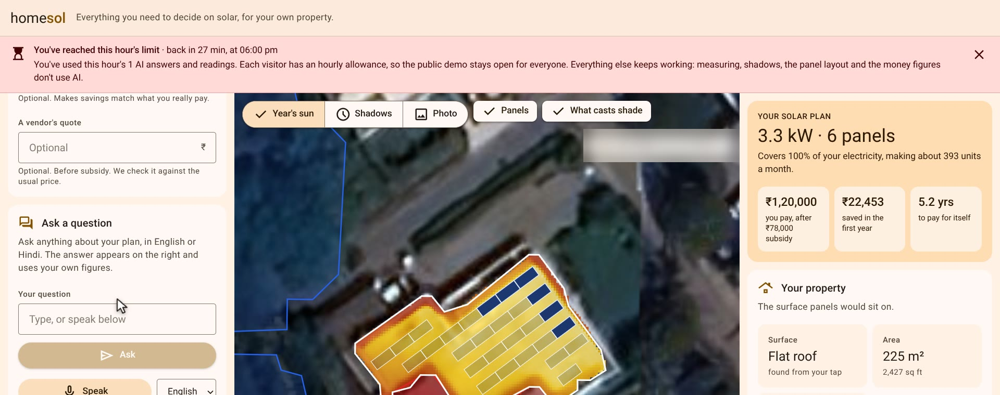

<sub>Screenshot taken with the AI allowance turned down to 1 to show the banner.</sub>

## Run it locally

You need Python 3.13, Node 20+ and pnpm. Two processes:

```bash
cd api
python3 -m venv .venv && .venv/bin/pip install -r requirements.txt
.venv/bin/uvicorn homesol.main:app --port 8000 --reload
```

```bash
cd web
pnpm install
pnpm dev          # http://localhost:3000
```

`api/.env` (git-ignored) holds the keys:

```
AWS_BEARER_TOKEN_BEDROCK=...
AWS_REGION=us-east-1
GOOGLE_MAPS_API_KEY=...
```

Without `RATE_LIMIT_TABLE` set, the API counts rate limits in memory. The rooftop skyline scan needs the phone's compass and tilt sensors, which browsers only expose over HTTPS: run `pnpm dev:https` and open `https://<your-computer's-ip>:3000` on a phone on the same Wi-Fi.

### Tests

None of these calls a paid service.

| Suite | Command | Tests |
|---|---|---|
| API: site model, finance, policy, bill reader, rate limits | `api/.venv/bin/python -m pytest api/tests` | 49 |
| Advisor checks and fact sheet, offline | `api/.venv/bin/python -m pytest api/evals` | 101 |
| Website: shadows, panel layout, sun, sizing, time zones, rate limits | `cd web && pnpm test` | 62 |
| Types and lint | `cd web && npx tsc --noEmit && pnpm lint` | |

The advisor test set itself, `api/.venv/bin/python api/evals/run.py`, makes about 80 paid conversations.

### Deploy

```bash
scripts/deploy.sh
```

Needs the AWS CLI logged in to the account that owns the resources. It packages the API and updates the Lambda, creates the rate-limit table and its permission if they are missing, copies the settings from `api/.env` to the function, builds the website against the API's address and publishes it on Amplify.

## Repository layout

```
homesol/
├── web/                    Website: Next.js 16 static export, React 19, MapLibre, Tailwind 4
│   └── src/
│       ├── app/            Page, layout, Material Design 3 theme
│       ├── components/     Planner, tools, map, map controls, results, rate-limit banner
│       └── lib/
│           ├── site/       Shadow simulation, panel layout, shade attribution, obstruction naming
│           ├── solar/      Sun position, sizing, yield, the estimate where there is no survey
│           ├── api.ts      API client and rate-limit handling
│           └── store.ts    App state
├── api/                    API: FastAPI, deployed to AWS Lambda
│   ├── homesol/            Site model, finance, policy, advisor agents, bill reader, speech,
│   │                       saved surveys, rate limits
│   ├── data/policies.json  Subsidy, tariffs and net metering, each with its source
│   ├── evals/              Advisor test set, checks, grader, and every run's results
│   └── tests/
├── demo/                   The 3-minute demo video: script, shot list, and the tools that recorded,
│                           narrated and assembled it
├── docs/
│   ├── how-it-works.md     Every system: how it works, settings, limits, troubleshooting
│   ├── handoff.md          What is verified, what is not, and open work
│   └── images/             Screenshots and charts for this page
└── scripts/deploy.sh       Deploys the API and the website
```

## Limits

homesol is a hackathon build, and [docs/handoff.md](docs/handoff.md) says plainly what has and has not been checked. The main ones:

- Google's 3D survey coverage is uneven: dense in the US, Europe, Japan and large cities, patchy elsewhere, and most of India is its lowest-detail tier. Without it, results are estimates and say so.
- One plan covers one roof face; the faces of a pitched roof are not yet added together.
- Subsidy, tariff and net-metering data cover India only, for four distributor families.
- Nothing has been tried on a real phone yet, and the bill reader has only seen mock bills.
- Claude 5 models were not available on this Bedrock account; switching is a change of setting.

## Data and credits

Google Solar API (3D survey, sunlight, imagery) · NASA POWER (monthly sunlight) · Esri World Imagery (base map) · Photon by Komoot on OpenStreetMap data (address search) · PM Surya Ghar and distributor tariff orders (policy data, linked from each entry in `api/data/policies.json`).
